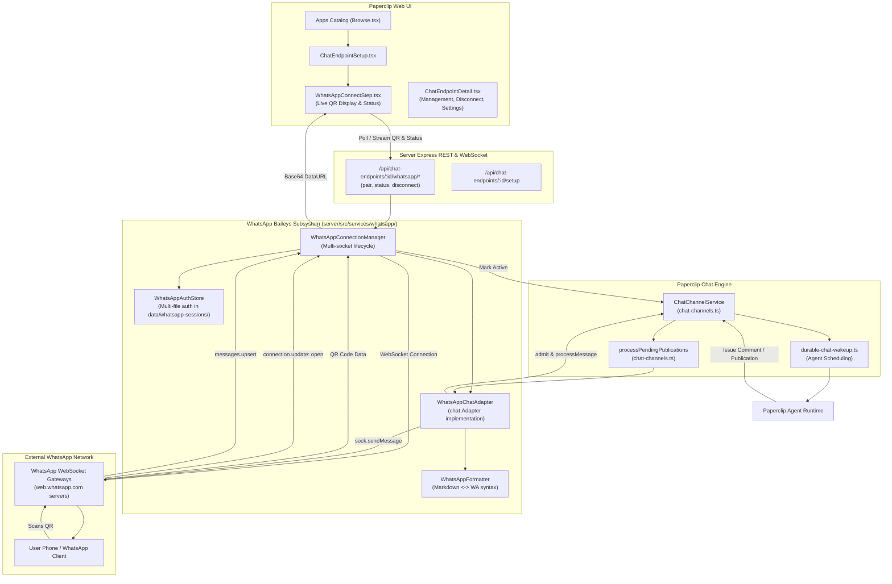
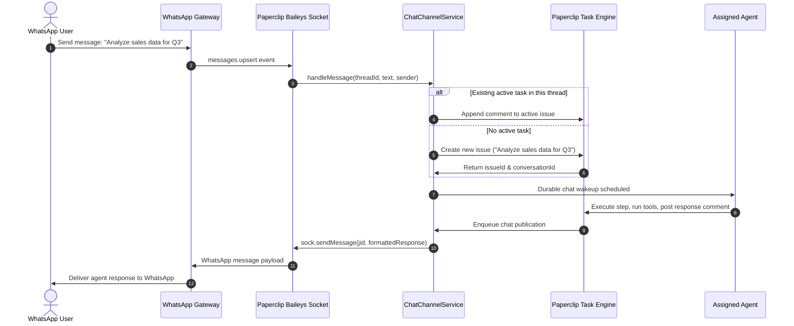

# WhatsApp Baileys Channel Connection Plan

**Date**: 2026-10-11  
**Status**: Proposed / Planning (`/plan`)  
**Target**: Add native WhatsApp channel connector using `@whiskeysockets/baileys` with QR code pairing for agent task creation and bidirectional chat.

---

## 1. Executive Summary

Users want to connect Paperclip agents to WhatsApp directly via QR code scanning in the Paperclip UI.
Once paired:
1. **Inbound**: A WhatsApp user sends a message (DM or authorized group) to the linked WhatsApp account.
2. **Task Creation / Continuation**: Paperclip automatically converts the message into a new task (or appends to an active task conversation) assigned to the designated agent.
3. **Execution & Wakeup**: The agent processes the task, reasons, and produces responses/comments.
4. **Outbound**: The agent's output is automatically formatted and published back to the WhatsApp conversation via Baileys.

---

## 2. Architecture & Component Interaction



---

## 3. Detailed Technical Design

### 3.1. Provider & Contract Extensions (`packages/shared`)

1. **`CHAT_PROVIDERS`**:
   - Extend `CHAT_PROVIDERS` in `packages/shared/src/types/chat-channels.ts` to include `"whatsapp"`.
   ```ts
   export const CHAT_PROVIDERS = [
     "slack",
     "github",
     "discord",
     "microsoft-teams",
     "telegram",
     "agentmail",
     "imessage-photon",
     "whatsapp",
   ] as const;
   ```
2. **Capabilities**:
   ```ts
   export const WHATSAPP_CAPABILITIES: ChatAdapterCapabilities = {
     threads: false, // WhatsApp chats are flat message threads
     directMessages: true,
     nativeStreaming: false,
     messageEdits: false,
     messageDeletes: false,
     reactions: true,
     files: true,
     cards: false,
     actions: false,
     modals: false,
     slashCommands: false,
     ephemeralMessages: false,
     proactiveDirectMessages: true,
   };
   ```
3. **Setup State**:
   - Extend `ChatEndpointSetupState`:
   ```ts
   export interface WhatsAppSetupState {
     status: "idle" | "qr_ready" | "connecting" | "connected" | "failed";
     qrCodeDataUrl?: string | null;
     pairingCode?: string | null;
     phoneNumber?: string | null;
     pushName?: string | null;
     lastError?: string | null;
     expiresAt?: string | null;
   }
   ```

### 3.2. Database Schema & Migration (`packages/db`)

1. **Table Constraints in `packages/db/src/schema/chat_channels.ts`**:
   - Update `chat_endpoints_provider_check`:
     ```sql
     provider in ('slack', 'github', 'discord', 'microsoft-teams', 'telegram', 'agentmail', 'imessage-photon', 'whatsapp')
     ```
   - Add single-active-endpoint constraint for WhatsApp phone numbers:
     ```ts
     uniqueIndex("chat_endpoints_whatsapp_number_uq")
       .on(table.botExternalId)
       .where(sql`${table.provider} = 'whatsapp' and ${table.status} <> 'archived' and ${table.botExternalId} is not null`);
     ```
2. **Drizzle Migration**:
   - Run `pnpm db:generate` to produce the versioned migration script updating the provider check and adding the unique partial index.

### 3.3. Baileys Integration Subsystem (`server/src/services/whatsapp/`)

Create modular service files under `server/src/services/whatsapp/`:

1. **`auth-store.ts` (`WhatsAppAuthStore`)**:
   - Implements multi-file auth persistence in `data/whatsapp-sessions/<companyId>/<endpointId>`.
   - Ensures directory permissions and safe removal upon endpoint disconnect or archival.
   - Provides safe JSON serialization of `Buffer` credentials matching Baileys expectations.

2. **`manager.ts` (`WhatsAppConnectionManager`)**:
   - In-memory registry of active `WASocket` instances keyed by `endpointId`.
   - **QR Code Lifecycle**:
     - Calls `makeWASocket({ auth, printQRInTerminal: false, logger })`.
     - Listens to `connection.update`:
       - If `update.qr`: converts QR string into a data URL with `qrcode.toDataURL(qr)` and stores in temporary memory / setup state.
       - If `update.connection === "open"`:
         - Retrieves authenticated user JID (`sock.user.id`, e.g. `628123456789:1@s.whatsapp.net`).
         - Normalizes phone number into E.164 (`+62 812-345-6789`).
         - Updates `chatEndpoints`: `status = "active"`, `botExternalId = phoneDigits`, `botUsername = formattedPhone`, `botDisplayName = sock.user.name ?? formattedPhone`.
       - If `update.connection === "close"`:
         - Checks `DisconnectReason`:
           - If `loggedOut` (401): marks endpoint status as `attention`, clears session files, removes socket from pool.
           - If `restartRequired` or network drop: applies exponential backoff reconnection.
   - **Endpoint Lifecycle Hooks**:
     - `start(endpointId)`: boots connection on server startup for all `active` endpoints.
     - `pair(endpointId)`: begins interactive pairing session.
     - `disconnect(endpointId)`: logs out and tears down socket.

3. **`adapter.ts` (`WhatsAppChatAdapter`)**:
   - Implements `chat.Adapter<WhatsAppThread, WAMessage>` interface.
   - `encodeThreadId` / `decodeThreadId`: format `whatsapp:<jid>`.
   - Inbound message parsing:
     - Extracts message text from `conversation`, `extendedTextMessage.text`, or media `caption`.
     - Maps sender JID to `ChatExternalPrincipal`.
     - Formats thread as 1-on-1 direct message or group conversation.
   - Outbound publication:
     - Implements `publish(threadId, publicationId, message, options)`:
       - Uses `WhatsAppFormatter` to convert Markdown to WhatsApp syntax.
       - Sends text or media via `sock.sendMessage(jid, ...)`.
       - Updates delivery confirmation in `chatPublications`.

4. **`formatter.ts` (`WhatsAppFormatter`)**:
   - Converts Markdown features into WhatsApp-supported markdown:
     - `**bold**` or `__bold__` $\to$ `*bold*`
     - `*italic*` or `_italic_` $\to$ `_italic_`
     - `~~strike~~` $\to$ `~strike~`
     - ```` ```code``` ```` $\to$ ```` ```code``` ````
     - Inline `` `code` `` $\to$ `` `code` ``
     - Numbered and bulleted lists formatted cleanly.
   - Message Chunking: Splits messages exceeding WhatsApp's 4,096 character threshold at paragraph boundaries.

### 3.4. REST API Routes (`server/src/routes/chat-channels.ts`)

1. `POST /api/chat-endpoints/:endpointId/whatsapp/pair`:
   - Validates user has board/management permissions.
   - Triggers `whatsAppManager.pair(endpointId)`.
   - Returns `{ qrCodeDataUrl: string, status: "qr_ready", expiresAt: string }`.
2. `GET /api/chat-endpoints/:endpointId/whatsapp/status`:
   - Returns current pairing / connection status, active QR code data URL (if still scanning), or connected phone details.
3. `POST /api/chat-endpoints/:endpointId/whatsapp/disconnect`:
   - Shuts down the Baileys socket, cleans up auth storage, and transitions endpoint to `paused` or `draft`.

### 3.5. UI Components (`ui/src/pages/apps/`)

1. **Apps Catalog (`ui/src/pages/apps/Browse.tsx`)**:
   - Add WhatsApp entry to `nativeChatApps` with official SVG icon and description:
     `"Connect Paperclip agents to WhatsApp via QR code scan using Baileys. Chat with agents, assign tasks, and receive responses directly in WhatsApp."`
2. **Connection Wizard Step (`WhatsAppConnectStep.tsx`)**:
   - Step 1: Select Agent (reuses existing `ChooseAgentStep`).
   - Step 2: `WhatsAppConnectStep`:
     - Displays live QR code image.
     - Auto-polls status every 3 seconds or listens for pairing completion.
     - Displays pairing steps:
       1. Buka aplikasi WhatsApp di HP Anda.
       2. Buka **Setelan** > **Perangkat Tertaut** (**Settings** > **Linked Devices**).
       3. Ketuk **Tautkan Perangkat** (**Link a Device**).
       4. Arahkan kamera HP ke kode QR di layar ini.
     - Refresh QR button if timed out.
   - Step 3: Test & Complete:
     - Shows connected phone number and green "Connected" badge.
     - Encourages sending a test message directly from WhatsApp.
3. **Endpoint Detail & Settings (`ChatEndpointDetail.tsx`)**:
   - Displays phone number, connection health, and disconnect/reconnect controls.
   - Configures DM permission (`allowDirectMessages`) and group permission (`allowGroupChats`).

---

## 4. Inbound Workflow & Task Execution



---

## 5. Security & Isolation Considerations

1. **Company Scoping**:
   - Endpoints are strictly scoped to `company_id`. Messages from an endpoint can only interact with issues and agents within that company.
2. **Session Credential Storage**:
   - Baileys credentials contain cryptographic private keys.
   - Files are stored in `data/whatsapp-sessions/<companyId>/<endpointId>` with strict OS file permissions.
   - When an endpoint is deleted or archived, all session files are purged immediately.
3. **Number Uniqueness**:
   - Database constraint ensures one WhatsApp phone number cannot be registered by two different endpoints simultaneously.
4. **Group Chat Governance**:
   - Group chats are disabled by default (`allowGroupChats: false`).
   - Senders can be restricted via `allowUnlinkedPeople: false` if operator requires identity linking to known Paperclip users.

---

## 6. Verification & Testing Plan

1. **Typecheck & Build**:
   - `pnpm -r typecheck` to confirm contracts across `packages/shared`, `packages/db`, `server`, and `ui`.
   - `pnpm build` ensures server packaging succeeds without bundle issues.
2. **Unit & Integration Tests**:
   - Markdown to WhatsApp formatter unit tests (`test/whatsapp-formatter.test.ts`).
   - Mocked Baileys socket integration tests verifying:
     - QR generation and expiry handling.
     - `connection.update` state transitions (`open`, `close`, `loggedOut`).
     - Inbound message parsing and task creation trigger.
     - Outbound message publication and error retry.
3. **Live End-to-End Verification**:
   - Run Paperclip server locally (`pnpm dev`).
   - Open Apps Catalog $\to$ Click WhatsApp $\to$ Select Agent $\to$ Click Connect.
   - Scan QR code using physical WhatsApp mobile app.
   - Verify connection status turns green and phone number is detected.
   - Send test WhatsApp message from phone $\to$ verify new Paperclip issue appears on board.
   - Verify agent response message arrives back on phone.

---

## 7. Open Questions & Recommendations

1. **Baileys Version Selection**:
   - Recommend `@whiskeysockets/baileys@^6.7.18` (or pure-JS 6.x release) to avoid native Rust/C++ compilation toolchain requirements on client machines, ensuring smooth installation across all platforms.
2. **Media Attachments**:
   - Initial V1 implementation focuses on text messages and QR pairing.
   - V2 phase can add image/document intake and outbound chart/file sending.
3. **Session Persistence on Cloud/Docker**:
   - By default uses filesystem storage in `data/whatsapp-sessions/`. In containerized environments, `data/` is already mounted as persistent volume in Paperclip.
