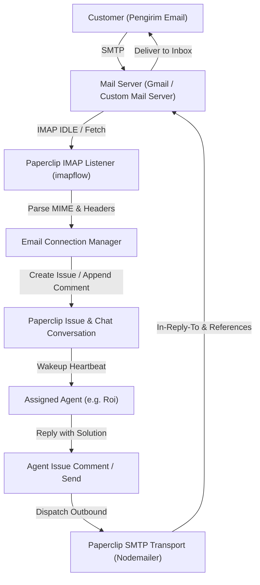

# Rencana Implementasi: Gmail & Custom Email Connector (SMTP / IMAP)

> **Tanggal**: 2026-10-12  
> **Status**: Proposed  
> **Target**: Paperclip V1 Apps & Chat Channels  

---

## 1. Latar Belakang & Tujuan

Pengguna membutuhkan konektor email yang fleksibel agar Agen AI di Paperclip dapat:
1. Membaca dan membalas email customer menggunakan akun **Gmail** (Google Workspace atau Gmail pribadi).
2. Mendukung **Custom Email Domain** (cPanel, Zoho, Microsoft 365, VPS Postfix/Dovecot) menggunakan protokol standar industri:
   - **SMTP** (Simple Mail Transfer Protocol): Untuk mengirim email balasan keluar (*outbound*).
   - **IMAP** (Internet Message Access Protocol): Untuk menerima dan memantau email masuk dari customer (*inbound*).
3. Mengelola percakapan customer secara otomatis:
   - Email masuk baru → Otomatis dibuatkan Issue / Task di Paperclip dan ditugaskan ke Agen yang dipilih.
   - Balasan customer berikutnya → Otomatis dikelompokkan ke dalam thread issue yang sama.
   - Balasan dari Agen → Dikirim kembali sebagai email resmi kepada customer dengan header RFC 2822 (`Message-ID`, `In-Reply-To`, `References`) yang tepat sehingga muncul dalam satu percakapan rapi di aplikasi email customer.

---

## 2. Arsitektur Teknis

### Protocol & Library Selection:
* **Outbound (SMTP)**: `nodemailer` (sudah ada di `server/package.json`).
  - Port 465 (SSL direct) & Port 587 (STARTTLS).
* **Inbound (IMAP)**: `imapflow` + `mailparser`.
  - Dukungan IMAP IDLE (notifikasi push instan tanpa polling berat).
  - Port 993 (SSL direct) & Port 143 (STARTTLS).
* **Keamanan Kredensial**: Password SMTP & IMAP disimpan terenkripsi di `company_secrets`.

---

## 3. Komponen yang Akan Dibuat & Dimodifikasi

1. **Shared Contracts (`packages/shared/`)**:
   - `types/chat-channels.ts`: Tambahkan `"email"` dan `"gmail"` pada `CHAT_PROVIDERS`.
   - `validators/email-connector.ts`: Zod schema validasi input form setup SMTP & IMAP.

2. **Backend Server (`server/`)**:
   - Install dependencies: `imapflow` dan `mailparser`.
   - `server/src/services/email/smtp-transport.ts`: Pengiriman email via Nodemailer & verifikasi SMTP handshake.
   - `server/src/services/email/imap-listener.ts`: Pemantauan inbox via ImapFlow IDLE & parsing email masuk.
   - `server/src/services/email/email-connection-manager.ts`: Orkestrasi koneksi aktif, mapping email ke Paperclip Issue/Conversation, dan pengiriman balasan agen.
   - `server/src/routes/email-connector.ts`: API endpoints untuk Test Connection, Setup, Status, dan Disconnect.

3. **Frontend UI (`ui/`)**:
   - `ui/src/pages/apps/Browse.tsx`: Tampilkan kartu Gmail dan Custom Email di katalog Apps.
   - `ui/src/pages/apps/chat/EmailConnectorSetup.tsx`: Wizard interaktif dengan tab Gmail (App Password/OAuth) dan Custom Email (Host, Port, User, Pass) lengkap dengan tombol **Test Connection** real-time.

---

## 4. Rencana Verifikasi

1. **Unit Testing**:
   - Test SMTP connection verification & header formatting (`In-Reply-To`, `References`).
   - Test IMAP MIME parsing & thread identification.
2. **End-to-End Test**:
   - Uji kirim email dari luar → Masuk ke Paperclip Issue → Agen membalas → Email balasan terkirim ke inbox pengirim.
